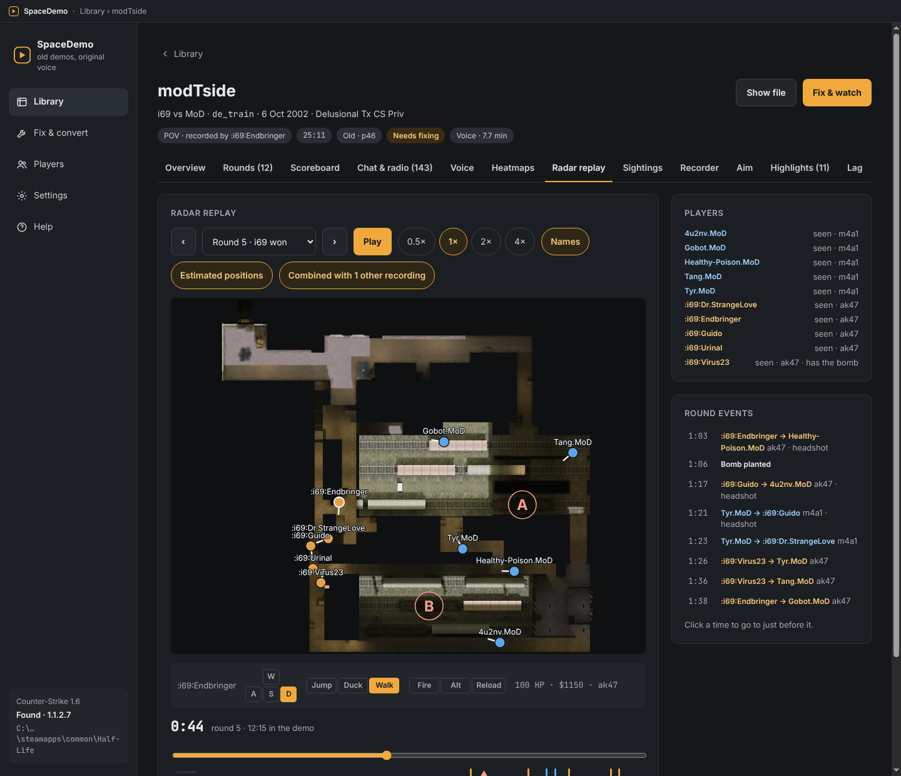
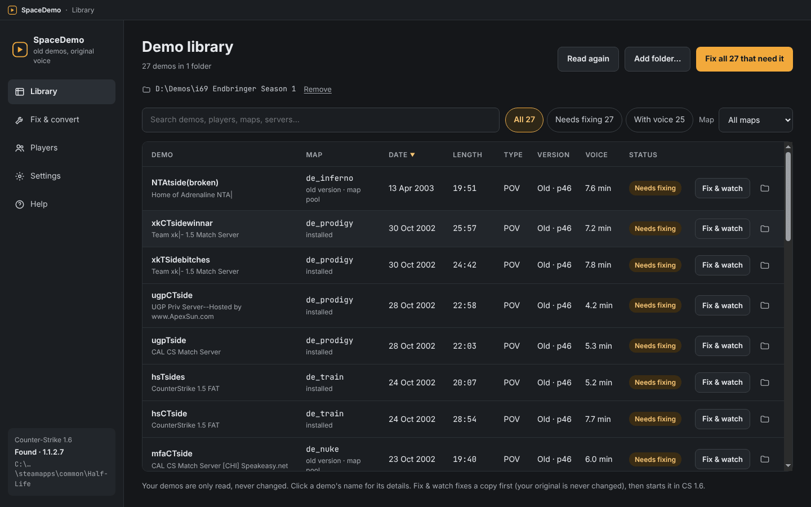
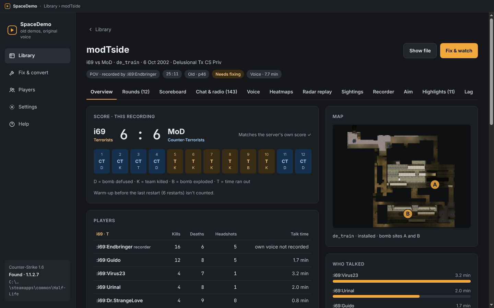
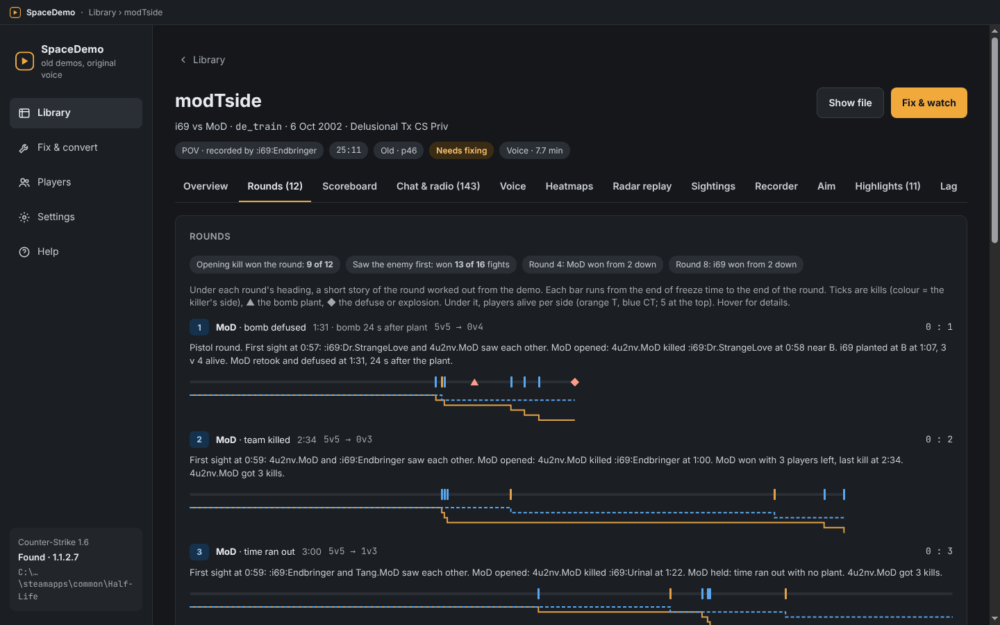
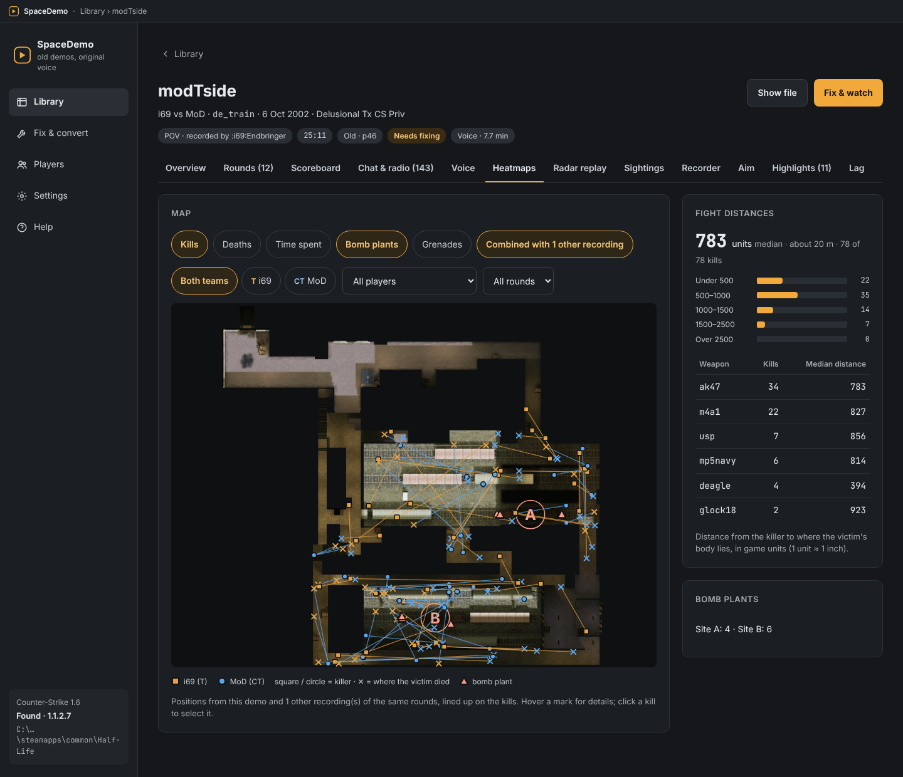
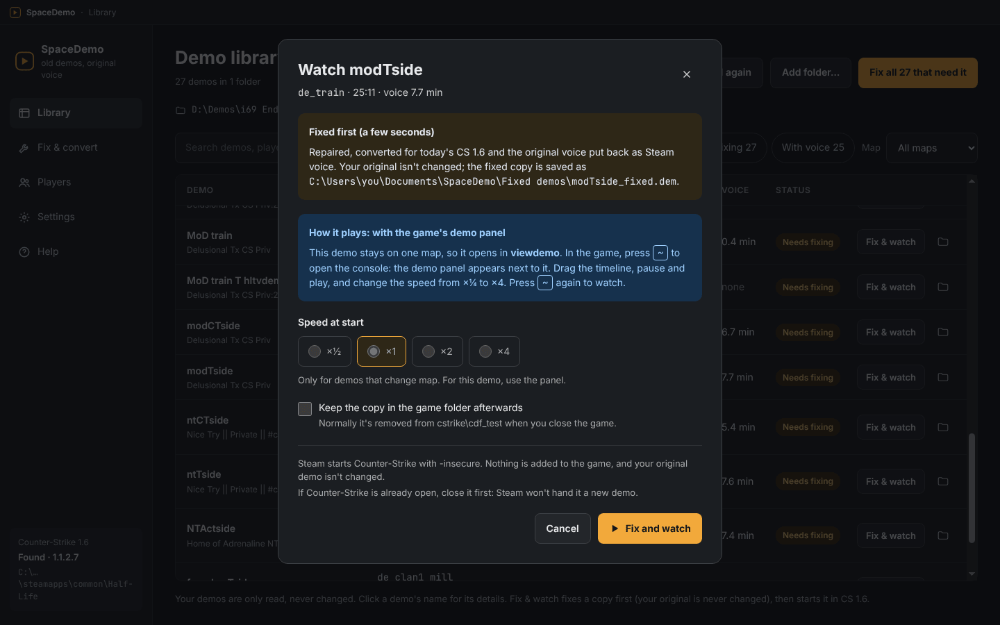

# SpaceDemo

**Watch old Counter-Strike demos (beta 6.5 and CS 1.0–1.6) in today's Steam CS 1.6, with the original voice.**

Demos recorded in 2001–2005 no longer play in today's game: the network format changed, the old voice codecs (Miles and Speex) are gone, and many maps have changed since. SpaceDemo repairs a copy of each demo, puts the players' original voice back as today's Steam voice, and starts it in Counter-Strike with one click. It also reads each demo and shows you the match: score, rounds, players, chat, who talked, a radar replay and more.

**[⬇ Download the latest version](https://github.com/SpaceisbigSoft/SpaceDemo/releases)** · **[User guide](docs/USER-GUIDE.md)** · **[Report a problem](https://github.com/SpaceisbigSoft/SpaceDemo/issues)**

> **Status: 0.9.0 beta** (test version) for Windows 10/11. Tested with over 100 demos from 2001–2005, player (POV) and HLTV.

## What it does

- **Plays old demos in today's CS 1.6.** It converts older network protocols (41 to 47 → 48, i.e. the late CS betas and CS 1.0 to early Steam CS 1.6), repairs recordings that were cut off, and finds the old version of a map when a demo needs it.
- **Brings back the voice.** Miles (WON era) and Speex (early Steam) voice is decoded and written back as Steam voice, so you hear the players in the game. Optional **AI voice enhancement** makes the 2002 voice fuller and clearer.
- **Playback controls:** pause, slow motion and fast forward with the game's own demo panel (press `~`).
- **Demo library:** add folders and zips (demos inside zips are read in place), then search and filter by player, map or server.
- **Match details:** rounds with a short story of each, scoreboard, chat and radio, voice timeline, heatmaps, a 2D radar replay with estimated positions, sightings, the recorder's money and aim, highlights and lag. If you have several recordings of one match, they're combined.
- **Players** across all your demos, with name changes recognised.
- **Voice to text** (optional): read and search what was said.
- **Updates itself** from GitHub releases, after asking you first.

## Screenshots

| | |
|---|---|
|  |  |
| **Library:** folders and zips, search and filters | **Match overview:** score, rounds, players, who talked |
|  |  |
| **Rounds:** what happened, round by round | **Heatmaps:** kills, deaths, plants, grenades |

*Screenshots: i69's 2002 league matches, recorded in CS 1.5.*

## Getting started

1. You need **Windows 10 or 11** and **Steam** with **Counter-Strike** installed.
2. Download `SpaceDemo-Setup-<version>.exe` from [Releases](https://github.com/SpaceisbigSoft/SpaceDemo/releases) and run it. The installer isn't signed, so Windows SmartScreen may warn you: click **More info → Run anyway**.
3. Open SpaceDemo, click **Add folder…** to add your old demos, then click **Fix & watch** on one.

While a demo plays, press `~` to open the demo panel. Everything else is in the [user guide](docs/USER-GUIDE.md) and on the **Help** page in the app.

## Safe for your files and your Steam account

- **Your demos are never changed.** Fixes are always saved as a new copy.
- **The game's files are never changed.** SpaceDemo only adds its own: the demo you watch (removed when the game closes) and old map versions, which go in a separate folder (renamed when today's map has the same name).
- **Nothing touches the running game:** no injection, no hooks, no memory reading. Demos start through Steam with `-insecure`, which turns VAC off for that session only.
- **Nothing about you is sent anywhere.** SpaceDemo only asks GitHub whether a newer version exists (you can turn this off) and downloads what you start yourself.
- SpaceDemo includes no Valve or RAD Game Tools files. Old Miles voice is decoded with the copy that comes with your own game.

## Credits

SpaceDemo's code is written from scratch, with thanks to the projects that showed the way:

- **[compLexity Demo Player](https://github.com/jpcy/coldemoplayer)** (COL) by jpcy and contributors: the pioneering CS 1.x demo player and converter, and a reference for how old demos differ from today's.
- **[CS Demo Manager](https://github.com/akiver/cs-demo-manager)** by AkiVer: inspiration for the interface.
- **SK Player** by Andreas Thorstensson: feature ideas.
- Community notes on the GoldSrc demo format, including the talent demo-structure notes (cgdangelo), and ReHLDS (map checksums).

Built with **Speex** and **Opus** (Xiph.Org), **[VoiceFixer](https://github.com/haoheliu/voicefixer)** by Haohe Liu et al. (AI voice; trained models CC BY 4.0, changed by SpaceDemo: combined, compressed and converted to ONNX), **OpenAI Whisper** via **whisper.cpp**, **ONNX Runtime**, **Electron**, **React**, and the Inter and JetBrains Mono fonts. Every component and its licence: [THIRD-PARTY-NOTICES.txt](THIRD-PARTY-NOTICES.txt). The same list is behind Settings → About in the app.

Counter-Strike and Half-Life are trademarks of Valve Corporation. SpaceDemo is not affiliated with Valve.

## Licence

Free software under the **GNU General Public License v3.0 or later**: see [LICENSE](LICENSE).

Developers: building, tests, tools and releases are described in [docs/DEVELOPING.md](docs/DEVELOPING.md).
